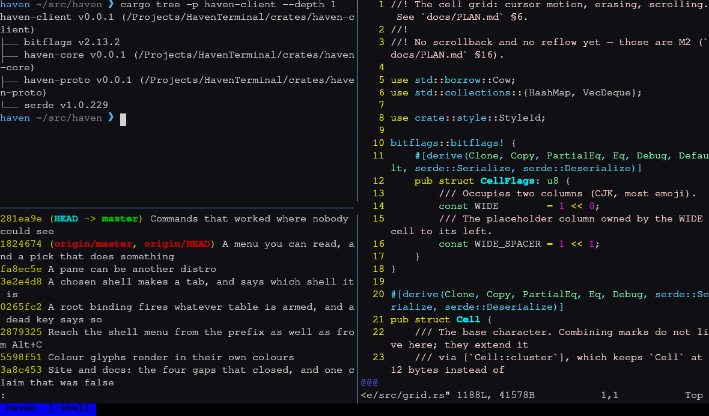

# Haven Terminal

A GPU terminal with the multiplexer already inside it.

Haven is a keyboard-first terminal emulator in Rust. Sessions, window tabs and
recursive pane splits are part of the core — not a tmux process layered on top,
translating escape sequences twice.

<b>Rust</b> · 13 crates · ~30k lines
<b>wgpu</b> Vulkan / Metal / DX12 / GL
<b>636</b> tests, zero clippy warnings
<b>MIT</b> OR Apache-2.0
v0.0.1 · <b>pre-release</b>

<a class="primary" href="./build.md">Build it</a>
<a href="./comparison.md">How it compares</a>
<a href="https://github.com/Lanpingner/Haven">GitHub</a>

One window, three panes, one process. Captured with
<code>haven screenshot</code>, which renders through the same GPU pipeline the
window uses — so this is the real renderer, not a mock-up.

## One codebase, one parser, one keymap

The usual stack is a GPU terminal that knows nothing about panes, with tmux
inside it re-parsing and re-emitting every byte. That costs a second VT
translation layer, a second keymap, a nested-escape-sequence tax, and two
programs that disagree about what a cell is. Haven removes the layer by owning
both halves.

The daemon owns the PTYs

Shells survive client exit, GPU crashes, SSH drops and logout. Several clients
can watch one session at once, each with its own size policy and its own scroll
position.

The GPU does the drawing

Instanced cell quads, a shelf-packed glyph atlas, damage-driven redraws,
vsync-paced frames, sRGB-correct colour, and box drawing computed rather than
looked up in a font.

The core is a pure state machine

`haven-core` is cells, styles, a grid and VT interpretation — no rendering, no
pty, no protocol. You drive it with byte slices, which is why it is testable at
all. CI fails the build if it ever links `wgpu` or `winit`.

The serializer is the parser, inverted

`haven-vtwrite` turns cells back into escape sequences: damage diffing, SGR
coalescing, a per-row cost model, scored scroll detection, synchronized output
and OKLab colour downsampling. That is what lets the same client draw into
another terminal.

Themes and bindings are data

The daemon owns the configuration, so one session looks the same through a
window and through SSH, and an edit reaches every attached client without a
reattach. A binding is a line in a file rather than a code change.

Correctness measured by real programs

`mc`, `vim` and `less` are driven on real ptys in the test suite — including mc
under `LANG=C`, mc's <kbd>Ctrl+O</kbd> subshell toggle, and `haven tui` running
inside `haven`.

## It runs three ways from one build

Two frontends over one mux core. Nothing is a degraded fallback: the TUI client
is a full client that happens to render with escape sequences instead of
triangles. See [run modes](./modes.md).

| | What it is |
|---|---|
| `haven gpu` | A desktop window attached to the daemon, which it starts if needed. Close the window; the session keeps running. Open two; they watch the same panes. |
| `haven attach` | The same session drawn into whatever terminal you are already in — over SSH, in a Linux console, inside another emulator. The tmux-replacement mode. |
| `haven tui` | The whole multiplexer in-process, no daemon, no socket, nothing left behind. |

## What it looks like

The palette and the session tree are panels the client draws, themed from the
same table as everything else. `mc` is there because it is the hardest common
program to get right — box drawing, the alternate screen, a subshell and the
mouse — and it is in the test suite for that reason, driven on a real pty.

## Status

**Usable, with plenty still ahead.** Sessions, splits, tabs, zoom,
attach/detach, scrollback, copy mode, the mouse, configurable bindings, save
and restore, [container panes](./containers.md), shell integration, themes and a
GPU window all work; `mc`, `vim` and `htop` render correctly. Plugins and live
daemon upgrade are not written yet.

The [status page](./status.md) lists what exists and what does not, and the
[design plan](./plan.md) tracks it milestone by milestone so the document cannot
drift from the tree.
